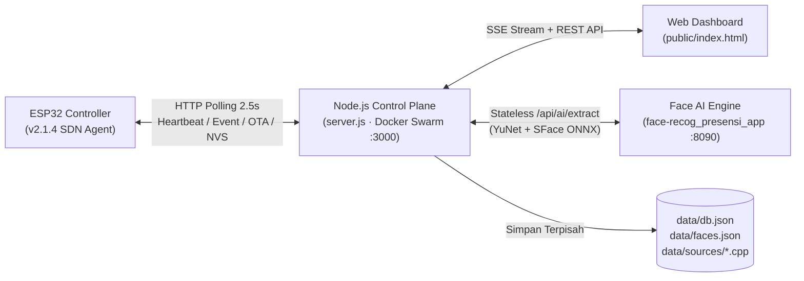

# Dokumentasi Teknis Lengkap: Centralized Access Door (ESP32 SDN + Web Control Plane + Face ID)

> **Domain Live**: `https://access-door.example.com` (`http://192.168.1.100:3000`)  
> **Versi Firmware Terbaru**: `v2.1.4` (`ESP32_CP2102` & `ESP32_S3`)

---

## 1. Arsitektur Sistem Secara Keseluruhan

Sistem ini terdiri dari **4 komponen utama** yang saling terhubung:

1. **ESP32 Controller** (`src/main.cpp`): Mengendalikan Relay Magnetic Lock, membaca kartu RFID Wiegand 26/32/34-bit, membunyikan Buzzer, membaca tombol Exit, melakukan *failover* otomatis ke memori NVS saat internet/server mati, menjalankan Cloud OTA, serta melaporkan isi source code & telemetry ke server.
2. **Backend Control Plane** (`server.js`): Mengelola state pintu, daftar kartu, log aktivitas, RBAC admin, Cloud OTA, SDN Runtime Policy, dan database wajah terpisah (`faces.json`).
3. **Web Dashboard** (`public/index.html`): UI real-time (SSE) untuk Kontrol Pintu, Buka Pakai Kamera (Face ID), Riwayat Log, Kartu RFID (dengan pelacak NVS per ESP32), Face ID & Role Pintu, SDN Fleet Orchestrator / Code Inspector, dan Manajemen Site & Pengguna.
4. **Stateless Face AI Engine** (`face-recog_presensi_app:8090`): Hanya dipanggil untuk mengekstrak vektor wajah 128-dimensi (`/api/ai/extract`) tanpa mencampur database MongoDB presensi.

---

## 2. Perbandingan Hardware & Schematic: ESP32 CP2102 vs ESP32-S3

> [!WARNING]
> **Apakah schematic & shield ESP32 CP2102 sama dengan ESP32-S3?**  
> **TIDAK SAMA!** Shield **DT-Y6593** (untuk ESP32 DevKit v1 30/38-pin) **tidak bisa langsung dicolok** ke board **ESP32-S3 DevKitC-1 (44-pin)** dan beberapa nomor GPIO-nya berbeda/hilang.

| Aspek | ESP32 CP2102 (`esp32dev`) | ESP32-S3 (`esp32-s3-devkitc-1`) |
| :--- | :--- | :--- |
| **Jumlah Pin Header** | 30-pin atau 38-pin | **44-pin (2x22 pin)** — fisik lebih panjang |
| **Konektor USB** | Micro-USB / USB-C via chip **CP2102** | **USB-C Native** (`USB` CDC) +/atau `UART` |
| **Kompatibilitas Shield `DT-Y6593`** | **Cocok langsung** (tinggal colok) | **Tidak muat**, wajib pakai breakout/shield 44-pin S3 atau wiring manual |
| **Pin Relay (`PIN_RELAY`)** | `GPIO 4` | `GPIO 4` (Aman) |
| **Pin Wiegand D0 (`PIN_D0`)** | `GPIO 18` | `GPIO 5` *(GPIO 18 aman, tapi dipindah biar rapi berurutan)* |
| **Pin Wiegand D1 (`PIN_D1`)** | `GPIO 19` | **`GPIO 6`** ⚠️ *(Wajib pindah! Di S3, GPIO 19 & 20 dipakai USB D-/D+ Native)* |
| **Pin Buzzer (`PIN_BEEP`)** | `GPIO 23` | **`GPIO 7`** ⚠️ *(GPIO 23 **tidak ada** di ESP32-S3)* |
| **Pin Tombol Exit (`PIN_EXIT`)** | `GPIO 27` | **`GPIO 15`** ⚠️ *(GPIO 27 **tidak ada** di ESP32-S3; 26-37 dipakai Flash/PSRAM)* |
| **Pin Strapping yang Dihindari** | GPIO 0, 2, 12, 15 | GPIO 0, 3, 45, 46, 19, 20, 26–37 |
| **Environment `platformio.ini`** | `env:esp32dev` | `env:esp32s3` (`ARDUINO_USB_CDC_ON_BOOT=1`) |

### Wiring Daya & Proteksi Magnetic Lock (Berlaku untuk CP2102 & S3)
- **Sumber Daya**: PSU 12V -> Step-down LM2596 (5V stabil) -> VIN/5V ESP32 + VCC Relay + HV Level Shifter 3.3V↔5V.
- **Kabel Magnetic Lock (Belden Cat6)**: Gunakan **2 kawat dipelintir per kutub** (total 4 kawat) dari kedua ujung agar arus ~500 mA tidak drop:
  - `+12V` (`PSU +V` -> `COM1` -> `NC1` Relay): `Hijau + Putih-Hijau` -> **Merah EM Lock**.
  - `GND` (`PSU -V` / WAGO PCT GND): `Oranye + Putih-Oranye` -> **Hitam EM Lock**.
- **Dioda Flyback `1N4007`** (paralel di Wago magnet / terminal NC1-GND):
  - **Ujung Gelang Perak (`Katoda`)** -> Jalur **Merah (`+12V` / `NC1`)**.
  - **Ujung Hitam Polos (`Anoda`)** -> Jalur **Hitam (`GND`)**.

---

## 3. Bedah Kode Firmware ESP32 (`esp32-firmware`)

### 3.1 `platformio.ini` & `embed_source.py`
- **`platformio.ini`**: Mendefinisikan 2 target kompilasi:
  - `[env:esp32dev]` (default): Untuk **ESP32 CP2102** (`board = esp32dev`).
  - `[env:esp32s3]`: Untuk **ESP32-S3** (`board = esp32-s3-devkitc-1`, mengaktifkan `ARDUINO_USB_CDC_ON_BOOT=1`).
- **`embed_source.py`**: Script *pre-build* Python yang menghitung hash **SHA-256** dari `src/main.cpp` lalu menghasilkan `include/embedded_source.h` berisi `FIRMWARE_CODE_HASH` (12 karakter pertama), `FIRMWARE_CODE_SHA256`, `EMBEDDED_SOURCE_LEN`, dan array `EMBEDDED_SOURCE_CODE[] PROGMEM` di Flash ROM (0 byte RAM tambahan).

### 3.2 `src/main.cpp` — Fungsi per Fungsi

| Baris / Bagian | Simbol / Fungsi | Penjelasan Cara Kerja |
| :--- | :--- | :--- |
| **1–53** | `#define FIRMWARE_VERSION`, `BOARD_TYPE`, Pinout `#if defined(CONFIG_IDF_TARGET_ESP32S3)` | Menentukan versi (`2.1.4`), tipe board (`ESP32_CP2102` vs `ESP32_S3`) otomatis saat kompilasi, dan memetakan pin GPIO yang aman untuk masing-masing board. |
| **38–60** | `SdnRuntimePolicy sdnPolicy` | Struct aturan runtime yang dikendalikan dari Cloud dan disimpan di NVS: `antiBruteforce`, `maxFails`, `lockoutSec`, `sameCardCooldownMs`, `exitInLockdown`, `buzzerEnabled`, `heartbeatIntervalMs`. |
| **65–102** | `emergencyAdminCards[]`, `syncedLocalCards`, `isrD0()`, `isrD1()` | Daftar kartu darurat hardcoded (`1078426`, `1957786`), vector kartu NVS + durasi custom per kartu (`LocalCardEntry`), dan interrupt Wiegand pin D0/D1. |
| **107–148** | `readerBeep()`, `readerBeepSuccess()`, `applyRelayState()`, `unlockDoor()` | `readerBeep()` untuk pola umum/penolakan; **`readerBeepSuccess()`** menghasilkan pola **3x beep (`90ms ON -> 150ms jeda -> 80ms ON -> 65ms jeda -> 80ms ON` = `beep .. beep beep`)**; `unlockDoor()` menyalakan relay sesuai `durationMs` (maks 60 detik). |
| **180–248** | `loadSdnPolicyFromNVS()`, `saveSdnPolicyToNVS()`, `syncSdnPolicyFromServer()` | Memuat policy dari Flash NVS saat boot dan otomatis mengunduh `/api/device/policy` jika `policyVersion` server berubah. |
| **250–357** | `loadOfflineCardsFromNVS()`, `saveOfflineCardsToNVS()`, `isAuthorizedOffline()`, `syncCardsFromServer()` | Menyimpan daftar `UID:durationMs` di NVS Flash. Saat offline/internet mati, kartu tetap diverifikasi lokal beserta durasi buka custom per kartunya. |
| **360–425** | `uploadEmbeddedSourceToServer()`, `sendFullTelemetryToServer()` | Mengirim isi asli `EMBEDDED_SOURCE_CODE` dari Flash ROM (`POST /api/device/source-upload`) dan snapshot telemetry (RSSI, BSSID, Channel, TxPower, Free Heap, Uptime, GPIO Pins, daftar kartu NVS, `boardType`, `chipModel`). |
| **427–482** | `performCloudOTA()` | Mengunduh `/api/device/firmware.bin` via `HTTPUpdate` dengan verifikasi MD5, reset Watchdog (`esp_task_wdt_reset()`), dan reboot otomatis ke firmware baru. |
| **522–592** | `registerFailedAttempt()`, `resetFailedAttempts()`, `sendCardTapToServer()` | Mengirim tap kartu ke `/api/device/event` (timeout 1.5s agar failover cepat). Jika gagal 3x berturut-turut, reader mengunci input (`lockout`) sesuai `sdnPolicy` dan mengirim `BRUTEFORCE_ALERT`. |
| **595–718** | `sendHeartbeat()` | Polling setiap `sdnPolicy.heartbeatIntervalMs` (default 2.5 detik) ke `/api/device/heartbeat`: menyinkronkan `mode` (`NORMAL`/`HOLD_OPEN`/`LOCKDOWN`), `unlockDurationMs`, perintah (`OPEN_ONCE`, `INSPECT_CODE`, `SYNC_CARDS`, `REBOOT`), `needSource`, `policyVersion`, `cardSyncVersion`, dan `otaEnabled`. |
| **720–795** | `applyWiFiMaxPerformance()`, `onWiFiEvent()`, `connectStrongestWiFi()` | Mematikan WiFi sleep (`WIFI_PS_NONE`), memaksimalkan Tx Power `19.5 dBm`, mengunci bandwidth `HT20`, serta melakukan `ALL_CHANNEL_SCAN` dan mengunci BSSID AP dengan sinyal (RSSI) terkuat. |
| **797–838** | `setup()` | Init Relay (terkunci), Serial, Buzzer, Exit Button, Wiegand ISR, mematikan Bluetooth (`btStop()`), memuat NVS Cards + SDN Policy, mengaktifkan Hardware Watchdog 15 detik (`esp_task_wdt`), dan scan WiFi. |
| **840–970** | `loop()` | Watchdog reset, cek Tombol Exit (panggil `readerBeepSuccess()` saat mode normal), decode bit Wiegand (26/32/34-bit) -> anti-spam -> cek server online -> failover NVS lokal, auto-lock timer relay, heartbeat, dan auto-reconnect WiFi jika putus >15 detik. |

---

## 4. Bedah Kode Backend (`web-server/server.js`)

### 4.1 Penyimpanan Data Persisten (`DATA_DIR`)
- `db.json`: Sites, akun admin (`SUPER_ADMIN`, `SITE_ADMIN`, `VIEWER`), data pintu (`doors`), kartu RFID (`cards`), log (`logs`), `cardSyncVersion`, dan `sdnStandardPolicy`.
- `faces.json`: Database wajah khusus Access Door (terpisah dari Docker presensi) berisi `id`, `name`, `role`, `active`, `defaultPolicy` (`PERMIT`/`DENY`), `doorRules` per pintu, `photoBase64`, dan `embedding` (128 angka).
- `firmware/latest.bin` & `firmware/meta.json`: Binary firmware aktif untuk Cloud OTA.
- `sources/<codeHash>.cpp`: Arsip isi source code C++ asli yang diunggah oleh masing-masing ESP32.

### 4.2 Daftar Endpoint API

#### A. Endpoint Perangkat ESP32 (Auth Header: `x-api-key`)
- `POST /api/device/heartbeat`: Terima status online, `boardType`, `chipModel`, `rssi`, `ip`, `firmwareVersion`, `codeHash`, `cardSyncVersion`, `policyVersion`, `uptimeSec`, `freeHeapKb`; konfirmasi `syncedUids` NVS; balas `mode`, `command`, `needSource`, `policyVersion`, `cardSyncVersion`, dan info `otaEnabled`.
- `GET /api/device/policy`: Kirim aturan SDN runtime per pintu.
- `POST /api/device/source-upload`: Terima raw `text/plain` source code dari Flash ESP32 dan simpan berdasarkan hash.
- `POST /api/device/telemetry`: Terima snapshot pin GPIO, WiFi, dan array kartu NVS (`nvsUids`).
- `GET /api/device/sync-cards`: Kirim daftar kartu aktif (`uids` & `entries` berformat `UID:unlockDurationMs`) yang diizinkan di pintu tersebut.
- `GET /api/device/firmware.bin`: Stream binary `.bin` untuk Cloud OTA.
- `POST /api/device/event`: Terima event `RFID_SCAN`, `EXIT_BUTTON`, `BRUTEFORCE_ALERT`, `OTA_STATUS`, dan `DOOR_SENSOR`.

#### B. Endpoint Admin Web (Auth Header: `x-admin-token`)
- **Auth & Realtime**: `POST /api/admin/login`, `GET /api/admin/state`, `GET /api/admin/stream` (SSE).
- **Site & RBAC Users (Super Admin)**: `POST/DELETE /api/admin/sites`, `POST/DELETE /api/admin/users` (enforces `SUPER_ADMIN` = `READ_WRITE` + `['*']`; `VIEWER` = `READ_ONLY`; `SITE_ADMIN` = fleksibel).
- **Kontrol Pintu**: `POST/DELETE /api/admin/doors` (termasuk `boardType`), `POST /api/admin/door/open`, `POST /api/admin/door/simulate-tap`, `POST /api/admin/door/mode`, `POST /api/admin/doors/bulk-mode`, `POST /api/admin/door/physical-state`.
- **Kartu RFID & Sync NVS**: `POST/PATCH/DELETE /api/admin/cards`, `POST /api/admin/cards/push-sync` (Massal / 1-1).
- **SDN & Cloud OTA**: `POST /api/admin/firmware/upload`, `POST /api/admin/firmware/rollout`, `GET /api/admin/door/:doorId/code`, `POST /api/admin/door/inspect`, `POST /api/admin/sdn/policy`.
- **Face ID Database & Unlock**: `GET /api/admin/face-db/status`, `GET/POST /api/admin/faces`, `PUT/DELETE /api/admin/faces/:faceId`, `POST /api/admin/door/face-unlock` (ekstrak fitur wajah via `/api/ai/extract`, cocokkan hanya dengan `faces.json`, cek role `PERMIT`/`DENY` per pintu).

---

## 5. Bedah Frontend Dashboard (`web-server/public/index.html`)

| Halaman / Modal | Fungsi Utama |
| :--- | :--- |
| **`page-doors` (`Kontrol Pintu`)** | Pilih Site & Pintu (menampilkan badge `ESP32 CP2102` / `ESP32-S3`), atur durasi buka cepat, tombol **Buka Pintu**, **Buka Pakai Kamera**, **Simpan Default**, **Mode Normal / Buka Terus / Lockdown**, serta aksi massal. |
| **`page-logs` (`Riwayat Log`)** | Filter log berdasarkan Site, Pintu, Jenis Kejadian (`RFID_IN`, `FACE_UNLOCK`, `EXIT_BUTTON`, `REMOTE`, `DENIED`, `WARN`), paginasi, dan tombol **Daftar** cepat untuk UID asing. |
| **`page-cards` (`Kartu RFID`)** | Tambah/edit kartu (durasi custom per kartu + izin pintu), **Filter per ESP32 Offline (`cardOfflineFilter`)**, **Summary Chip Klik-Cepat**, badge status NVS (`Terdaftar` / `Pending` / `Stale` / `Cloud Only`), modal detail NVS per pintu, serta tampilan **Kartu / Tabel Padat + Paginasi**. |
| **`page-faces` (`Face ID & Role`)** | Daftarkan wajah via kamera atau upload foto ke DB khusus Access Door, atur `Default Policy` & toggle **`PERMIT` / `DENY`** per masing-masing pintu. |
| **`page-firmware` (`Kode ESP32`)** | **SDN Fleet Orchestrator** (status online, RSSI/RAM/Uptime, tipe board, hash kode, drift policy & NVS, tombol **Isi Kode**, **Policy**, **Sync**, **Push OTA**, **Reboot**), **Upload Cloud OTA Massal/1-1**, serta **Generator Kode** yang mendukung **ESP32 CP2102** dan **ESP32-S3**. |
| **`page-admin` (`Site & Pengguna`)** | Kelola lokasi Site dan akun admin dengan kunci logika RBAC (`Super Admin`, `Site Admin`, `Viewer`). |

---

## 6. Cara Build & Update Firmware Sendiri (Workflow Cepat)
1. Edit [src/main.cpp](../esp32-firmware/src/main.cpp) lalu naikkan `#define FIRMWARE_VERSION "2.1.x"`.
2. Build `.bin` di Terminal tanpa perlu colok kabel USB:
   - Untuk **ESP32 CP2102**: `~/.platformio/penv/bin/pio run -d esp32-firmware -e esp32dev` ➔ `.pio/build/esp32dev/firmware.bin`
   - Untuk **ESP32-S3**: `~/.platformio/penv/bin/pio run -d esp32-firmware -e esp32s3` ➔ `.pio/build/esp32s3/firmware.bin`
3. Upload file `.bin` via **`https://access-door.example.com` ➔ `Kode ESP32` ➔ `Upload & Jalankan OTA`**.
